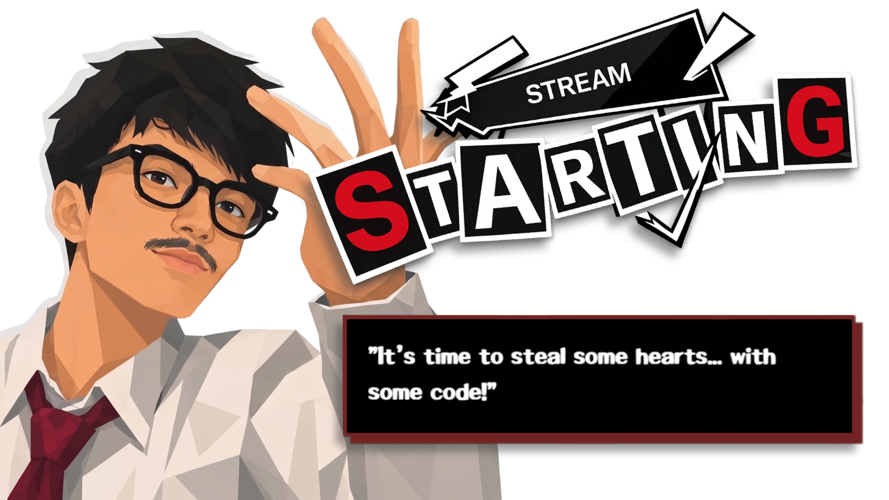

<h1 align="center">
  
</h1>

## 🃏 ABOUT ME

Hey! I'm **Muhammad Jawad Bufthem**, a Computer Science student at **Institut Teknologi Sepuluh Nopember (ITS)**, Indonesia.

I'm passionate about turning ideas into reality through code, whether it's building interactive games, developing web applications, or solving challenging programming problems. I enjoy exploring the intersection of technology and creativity, constantly learning new things and experimenting with different ideas.

- **Game Development:** Building games with Unity and C#, from 2D platformers to experimental gameplay projects.
- **Web Development:** Creating interactive web experiences using React and modern frontend technologies.
- **AI & Machine Learning:** Exploring artificial intelligence and computer vision, with plenty more to learn and build.
- **Creative Media:** Combining my technical skills with video editing and visual storytelling.

I believe the best way to learn is by building, experimenting, making mistakes, and improving with every project. I'm always looking for new challenges that push me beyond what I already know.

**Currently:** Learning more about Algorithms, AI/Machine Learning, Data Science, Game Programming, and collaborative software development.

## 🔗 Connect with Me

      
  

<picture data-importer="pacman">
  <source media="(prefers-color-scheme: dark)" srcset="https://raw.githubusercontent.com/mjawadb/mjawadb/pacman-output/bomberman-contribution-graph-dark.svg?game=bomberman">
  <source media="(prefers-color-scheme: light)" srcset="https://raw.githubusercontent.com/mjawadb/mjawadb/pacman-output/bomberman-contribution-graph.svg?game=bomberman">
  
</picture>

###

